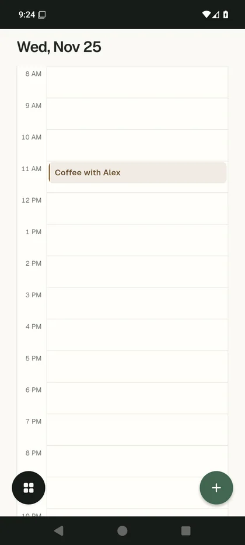

# Android Calendar after a day swipe

The Android 36 emulator captured this preview from a synthetic workspace running `477594a`. The hour labels fit the existing gutter, including 10 AM, 11 AM and 12 PM. [Runtime proof](https://github.com/launchsites/easy/actions/runs/45364549136) · [Verification manifest](manifest.json)

