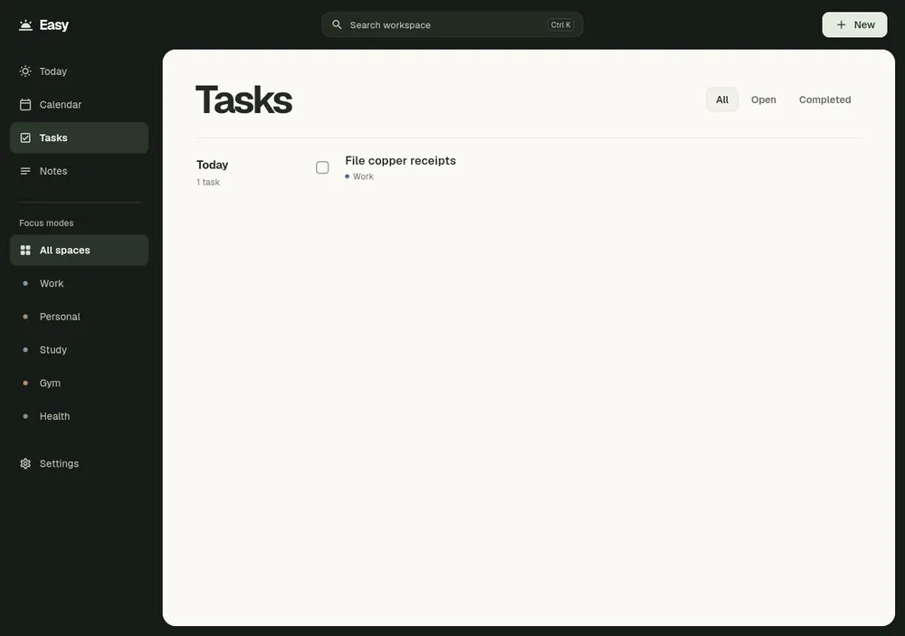
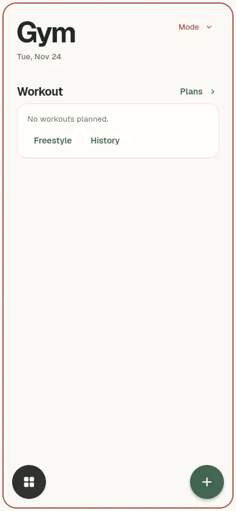
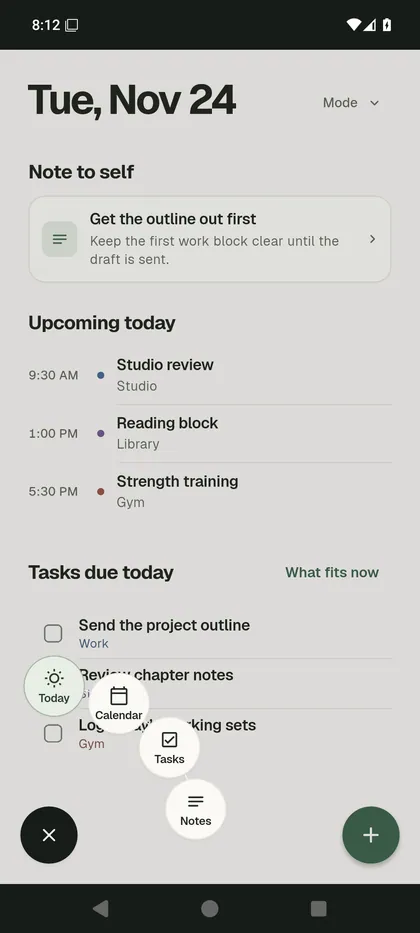
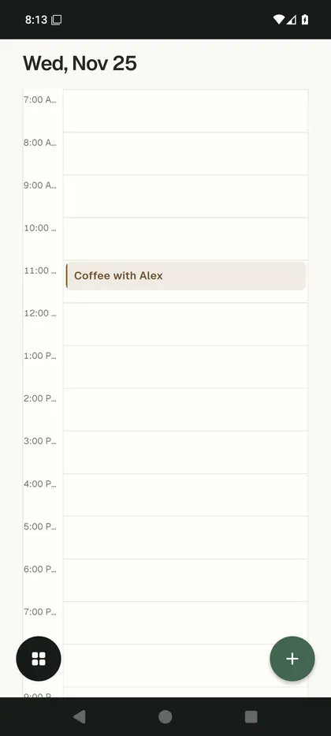

# Easy runtime previews

These screenshots use synthetic workspaces from the Linux and Android runs for `ecdc55a`. The previews are compressed for the gallery. The manifest records the original and preview checksums. [Verification manifest](manifest.json)

## Desktop tasks

## Mobile

| Gym | Navigation | Calendar |
| --- | --- | --- |
|  |  |  |

[Linux runtime proof](https://github.com/launchsites/easy/actions/runs/45357107699) · [Android runtime proof](https://github.com/launchsites/easy/actions/runs/45353884908)
